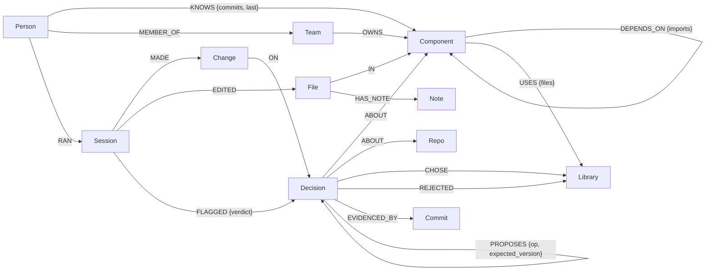
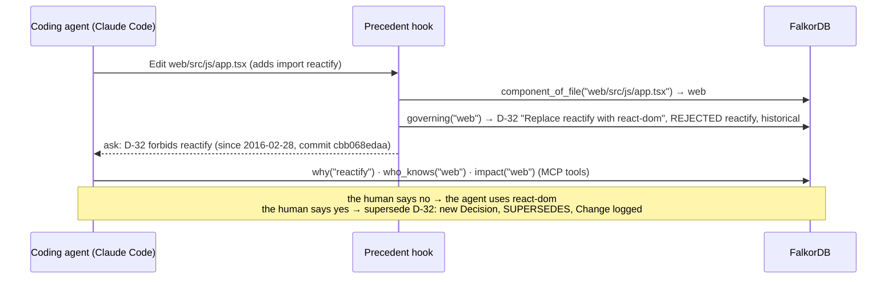

# Precedent

**A shared decision graph for coding agents, on FalkorDB.** It starts from zero on any repo (code + git, no docs,
0 LLM tokens), stops agents from silently undoing past decisions, and lets agents record new decisions safely
in a graph shared by many people and many harnesses.

> Graph Hacks: Context for AI Agents (WeMakeDevs × FalkorDB), Oct 15-18 2026.
> Tracks: **03 Company Brain** (primary), **02 Agent Memory and Coordination**, 01 Agents That Act on Connected Data.

**Measured on 7 real repositories** (NetBox, mitmproxy, paperless-ngx, Wagtail, Outline, Saleor, Sentry):
cold start with **0 LLM tokens** on all of them (Sentry: 112k commits in 8 min) · mined decisions **96% precise** (115/120 audited) ·
**8 false alarms in 45,240 real later commits (0.02%)** · **259/261** removed-library decisions caught when their code is put back ·
**agent A/B:** asked for a library the team removed on purpose, Claude Code put it back in **6/9 tasks without Precedent, 0/9 with it** ·
8 concurrent agents with injected mistakes: **0** unauthorized changes · `check()` **2.5 ms flat** up to 80k files.

- Plan and design reasoning: [docs/PLAN.md](docs/PLAN.md)
- Measured results (real repo + synthetic volume): [docs/RESULTS.md](docs/RESULTS.md)
- AI usage disclosure: [AI_USAGE.md](AI_USAGE.md) (built with Claude Code as a coding assistant; the core queries and write policy are hand-written)

## Why

Coding agents forget *why* the code is the way it is. Netbox replaced graphene with Strawberry in 2024
([commit 45c99e44](https://github.com/netbox-community/netbox/commit/45c99e4477)); an agent asked to "add a GraphQL type"
can happily pull graphene back in. A note in CLAUDE.md is advice; a hook is enforcement. And when several people's
agents share one memory, the hard problem is not reading, it's **writing safely**.

## What it does

| Problem | Precedent |
|---|---|
| No decision docs exist | `precedent init` reads the repo itself: folders → components, imports → dependencies, manifest history → "library X was removed/replaced in commit C" (with the commit as the source), git log → who knows what, AGENTS.md/comments → candidate rules. **0 tokens, 13 s on netbox** |
| Agents don't read memory on purpose | Hooks attach ≤ 5 relevant lines when the agent **reads** a file, and check every **edit** (deny / ask / allow). Silent when nothing applies |
| Agents must write decisions too | 15 MCP tools; writes go through one `policy()`: new decisions apply, duplicates/conflicts are refused, protected ones become **proposals a human approves** in the harness's own prompt |
| A wrong overwrite | Nothing is deleted. Supersede = new node + `SUPERSEDES` + `valid_to`. Every write is a `Change` node; `revert(change)` undoes it |
| Many agents, one graph | Version check-and-set in one Cypher statement: a stale writer gets "D-12 changed since you read it: now v3, superseded by D-40 (other-bot, 2 min ago)" |
| Who may change what | Trust ladder `observed < historical < agent < documented < human`, plus `locked` (only the owning team, checked **in the graph**) |

## Quick start

```bash
# FalkorDB (any way you like; we run it in WSL, docker works too)
docker run -p 6379:6379 -it --rm falkordb/falkordb

uv venv .venv --python 3.12 && uv pip install falkordb==1.7.1 mcp==2.3.0 pyyaml pytest
python -m pytest tests                                   # 13 end-to-end tests on a live FalkorDB

python -m precedent init /path/to/repo                   # cold start, graph named after the folder
python -m precedent install /path/to/repo                # Claude Code: MCP + hooks + permissions + /precedent-onboard; git pre-commit
cd /path/to/repo && claude                               # then try: /precedent-onboard
python -m precedent --graph repo review                  # proposals waiting for a human
python -m precedent --graph repo approve D-51
python -m precedent --graph repo log                     # the graph's own change log
python -m precedent --graph repo revert C-12 "wrong call"
```

## Graph model



Every node with its properties:

```
(:Repo)                           (:Component {name})<-[:IN]-(:File {path})-[:HAS_NOTE]->(:Note {line, kind, text})
(:Component)-[:DEPENDS_ON {imports, valid_from, valid_to?}]->(:Component)
(:Component)-[:USES {files}]->(:Library {name, why, present, since})
(:Person {key, name, emails})-[:KNOWS {commits, last}]->(:Component)
(:Person)-[:MEMBER_OF]->(:Team)-[:OWNS]->(:Component)
(:Decision {id, title, rationale, status, trust, locked, version, forbid[], paths[], valid_from, valid_to?, actor, source})
(:Decision)-[:ABOUT]->(:Component | :Repo)
(:Decision)-[:CHOSE | :REJECTED]->(:Library)
(:Decision)-[:SUPERSEDES {at}]->(:Decision)          (:Decision)-[:PROPOSES {op, expected_version}]->(:Decision)
(:Decision)-[:EVIDENCED_BY]->(:Commit {sha, at, subject, author})
(:Person)-[:RAN]->(:Session {id, harness})-[:MADE]->(:Change {id, op, actor, kind, reason, before, after})-[:ON]->(:Decision)
(:Session)-[:EDITED]->(:File)   (:Session)-[:SAW]->(:Decision)   (:Session)-[:FLAGGED {verdict}]->(:Decision)
```

Decision `status`: `active | proposed | superseded | retired | rejected | reverted | applied`. Open intervals are a
**missing** `valid_to` (FalkorDB stores no nulls). Times are epoch ms.

## How the agent's decisions come from the graph

A real case from the mitmproxy graph: an agent adds `import reactify` to a file under `web/`.



Take FalkorDB out and nothing is left: the edit guard, the context an agent reads, and every write
(check-and-set, proposals, revert, the change log) are Cypher on the graph.

## The Cypher the product depends on

All in [`precedent/queries/`](precedent/queries) (plus the writes in [`store.py`](precedent/store.py)):

| Query | Used by | What |
|---|---|---|
| `governing.cypher` | every check, every Read hook | active decisions about a file's component + repo-wide ones (index-anchored, `WITH` barrier, UNION) |
| `impact.cypher` | `impact` | dependents up to 3 hops over current `DEPENDS_ON` edges, with their decisions |
| `lineage.cypher` | `why` | the `SUPERSEDES` chain in both directions |
| `as_of.cypher` | `why(as_of=)` | decisions in force on a date (`valid_from <= t < valid_to`) |
| `who_knows.cypher` | `who_knows` | people by commits on the component |
| `history.cypher` | SessionStart, `history` | the change log, excluding your own session |
| `search.cypher` | `search` | full-text index over decisions |
| `store._apply_end` | supersede / retire / approve | **check-and-set**: `MATCH (o {id}) WHERE o.version = $v AND o.status = 'active' SET ...` |

## MCP tools

Read: `context`, `check`, `why`, `impact`, `who_knows`, `history`, `search`, `query` (read-only Cypher, LIMIT forced), `pending`.
Write (policy-gated): `record_decision`, `supersede`, `amend`, `retire`, `revert`, `approve` (human-gated).

## Hooks (Claude Code; Cursor has the same events)

| Event | Does |
|---|---|
| SessionStart | 3-line brief + what *other* people/agents changed since your last session + proposals waiting |
| PostToolUse `Read` | the decisions about that file, each once per session (`additionalContext`), nothing if none |
| PreToolUse `Edit\|Write\|MultiEdit` | `check()` → `deny` (documented/human/locked) or `ask` (historical/agent), with reason + source |
| PostToolUse `Edit\|Write` | `Session-[:EDITED]->File`; nudge to record a decision when a new dependency appears |
| PreToolUse `mcp__precedent__approve` | always `ask`: the human is the one approving |
| git pre-commit | `precedent check-staged`: deny-level violations block the commit, for any harness or human |

Hooks run `precedent.hook_client` (standard library only), which forwards each event to a local daemon holding the
graph connection (`precedent serve`, started on first use, stops after 30 idle minutes): ~0.25 s per hook instead of ~0.8 s.

## FalkorDB lessons (measured)

- One-pattern queries like `(c:Component {name})<-[:ABOUT]-(d:Decision {status:'active'})` made the planner start
  from **all** decisions (24 ms at 19k). Anchor + `WITH` barrier: **0.6 ms**. An index on `Decision.status` made it worse.
- Two pattern comprehensions in one `RETURN` that reuse a variable name silently return `[]`.
- `STARTS WITH $p + '/'` parses as `(... STARTS WITH $p) + '/'`: pass the full string as a parameter.
- `UNION` halves need identical column aliases.
- On Windows, connect to `127.0.0.1`, not `localhost` (IPv6 first: +2.5 s per hook).

## Layout

```
precedent/  scan.py (cold start)  tools.py (read)  store.py (write + policy)  hook.py  hook_client.py  serve.py
            mcp_server.py  cli.py  queries/  assets/precedent-onboard.md
tests/      end-to-end tests + MCP smoke test
sim/        world.py (synthetic monorepo)  agents.py (multi-agent simulation with injected mistakes)
eval/       coldstart.py  replay.py (real history replay)  agent_ab.py (A/B with real Claude Code)  bench.py (scale)
            mcp_wire.py (raw MCP traffic)  summary.py  run_all.sh  out/ (results)  logs/
docs/       PLAN.md  RESULTS.md
```
