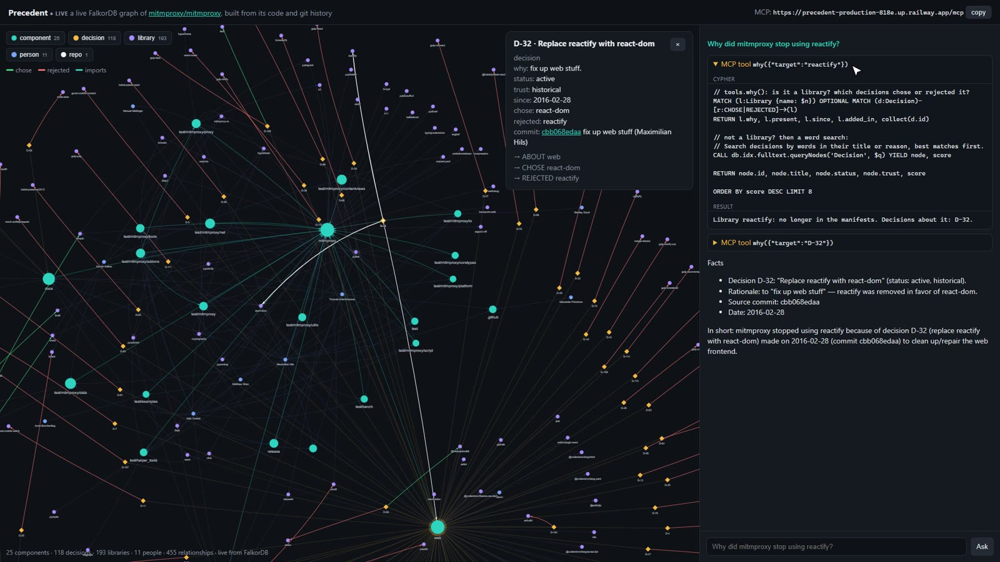
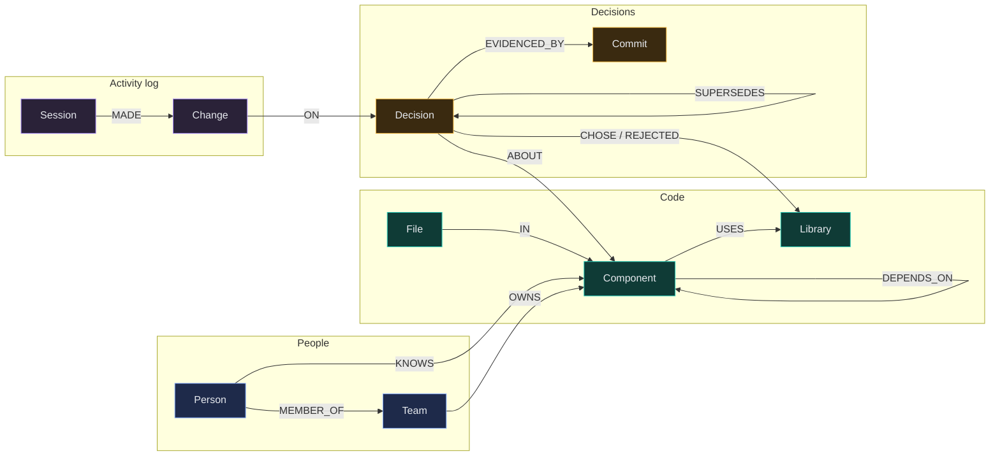
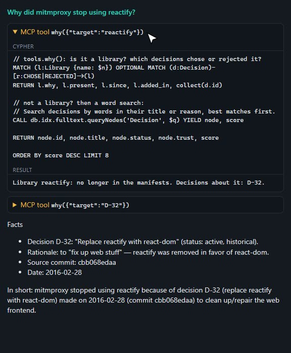

# Precedent

**A shared memory of *why* for coding agents, built on FalkorDB.**
Precedent turns a repo's code and git history into a decision graph, then checks every edit an agent makes against it.

**[Live demo](https://precedent-production-818e.up.railway.app/)** · **Tracks:** Company Brain, Agent Memory and Coordination · Built for Graph Hacks (WeMakeDevs × FalkorDB)



---

## Why I built it

I use coding agents every day, mostly Claude Code. With AI-assisted development, code changes faster than a team can share the reasons behind it.

A real example: LangGraph saves to Postgres with **psycopg**, which is LGPL, and our clients' legal teams won't ship that. So a teammate rewrote it on **asyncpg**. If I don't know that, my agent sees custom code, swaps it back to psycopg, and the tests still pass.

The agent read the code. The reason was never in the code. Precedent gives every agent on the team the same memory of **what** was decided, **why**, **who** decided it, **since when**, and **what it replaced**.

---

## How it fits together

```mermaid
flowchart LR
    subgraph repo["Your repo"]
        code["code + git history"]
    end
    subgraph falkor["FalkorDB"]
        graph[("decision graph<br/>one graph per repo")]
    end
    subgraph agent["Your coding agent (Claude Code, Cursor, ...)"]
        hooks["hooks<br/>check every edit"]
        mcp["MCP tools<br/>why · impact · who_knows · record"]
    end
    code -- "precedent init<br/>(0 LLM tokens)" --> graph
    hooks -- "Cypher" --> graph
    mcp -- "Cypher (reads + safe writes)" --> graph
    commit["git pre-commit"] -- "Cypher" --> graph
```

1. **`precedent init`** reads the repo (folders, imports, git log, every version of the manifests) and builds the graph. No AI calls.
2. **Hooks** run on every agent edit. If the edit brings back something a decision removed, the agent is stopped with the reason and the commit. Otherwise they stay silent.
3. **MCP tools** let the agent ask *why*, *what depends on this*, *who knows this*, and record new decisions.
4. **Writes are safe for many agents at once**: one policy, a version check inside a single Cypher statement, and a change log you can revert.

Take FalkorDB out and nothing is left: every check, answer and write is a Cypher query on the graph.

---

## The graph



| Node | In plain words | Example (mitmproxy) |
|---|---|---|
| **Component** | a part of the code, from the folder layout | `web/` |
| **Library** | a package the code uses or used | `reactify` |
| **Decision** | a choice the team made, with the reason and where it came from | D-32 "Replace reactify with react-dom" |
| **Commit** | the git commit that shows the decision | `cbb068edaa` (2016) |
| **Person / Team** | who knows a part of the code (from git log) and who owns it | the top committers of `web/` |
| **Session / Change** | every write by any person or agent, so you can see and undo it | "C-15: agent recorded D-56" |

Decisions are never deleted. An old one gets an end date (`valid_to`) and the new one points to it with `SUPERSEDES`, so you can ask what was true on any date. No end date means *still true*.
<details><summary>Every node and relationship, with properties</summary>

```
(:Repo {name})                     (:File {path})-[:IN]->(:Component {name})      (:File)-[:HAS_NOTE]->(:Note {line, kind, text})
(:Component)-[:DEPENDS_ON {imports, valid_from, valid_to}]->(:Component)
(:Component)-[:USES {files}]->(:Library {name, why, present, since})
(:Person {key, name, emails})-[:KNOWS {commits, last}]->(:Component)
(:Person)-[:MEMBER_OF]->(:Team {name})-[:OWNS]->(:Component)
(:Decision {id, title, rationale, status, trust, locked, version, forbid[], paths[], valid_from, valid_to, actor, source})
(:Decision)-[:ABOUT]->(:Component | :Repo)          (:Decision)-[:CHOSE | :REJECTED]->(:Library)
(:Decision)-[:EVIDENCED_BY]->(:Commit {sha, at, subject, author})
(:Decision)-[:SUPERSEDES {at}]->(:Decision)         (:Decision)-[:PROPOSES {op, expected_version}]->(:Decision)
(:Person)-[:RAN]->(:Session {id, harness})-[:MADE]->(:Change {id, op, actor, reason, before, after})-[:ON]->(:Decision)
(:Session)-[:EDITED]->(:File)    (:Session)-[:SAW]->(:Decision)    (:Session)-[:FLAGGED {verdict}]->(:Decision)
```

`status`: active, proposed, superseded, retired, rejected, reverted, applied. `trust`: observed < historical < agent < documented < human. Times are epoch ms.
</details>

---

## See it work

A real Claude Code run (Opus 5.5) in a clone of mitmproxy with Precedent installed. The request: *"Add reactify (version ^1.1.1) to the devDependencies in web/package.json."*

```text
● Update(web/package.json)
    + "reactify": "^1.1.1",

  PreToolUse:Edit hook blocked this edit
  Precedent: this edit to web/package.json conflicts with 1 decision(s):
  - D-32 v1 [historical] Replace reactify with react-dom (since 2016-02-28, source commit:cbb068edaa).
    Forbids: reactify. Why: fix up web stuff.
  If this is intentional, the user can approve; then record why with supersede('D-32', expected_version=1, title, rationale).

● I didn't make the change. The repo's Precedent hook blocked the edit to web/package.json because it
  conflicts with a recorded decision: D-32 (2016-02-28, commit cbb068edaa) "Replace reactify with react-dom".
```

The live demo shows the same thing from the other side. The chat model can **only** use Precedent's MCP tools, and every call shows the Cypher behind it:



---

## Setup (about 5 minutes)

You need **Python 3.12**, **git**, **Docker** (or any other way to run FalkorDB), and **Claude Code** for step 6.

**1. Start FalkorDB**

```bash
docker run -d --name falkordb -p 6379:6379 falkordb/falkordb
```

You should see: a container id. `docker exec falkordb redis-cli ping` answers `PONG`.

**2. Get Precedent and install it**

The virtual environment must be called `.venv` and live in this folder, because `precedent install` points the hooks at it.

```bash
git clone https://github.com/shantam77/precedent
cd precedent
python -m venv .venv
source .venv/bin/activate          # Windows: .venv\Scripts\activate
pip install -r requirements.txt
```

**3. Check that everything works**

```bash
python -m pytest tests -q
```

You should see: `13 passed`. The tests build a small git repo on the fly and run the whole flow against your FalkorDB.

**4. Build the graph for a real repo**

```bash
git clone https://github.com/mitmproxy/mitmproxy ../mitmproxy
git -C ../mitmproxy checkout 77355977e5ea540b51ed029a40ed1dc2f1c2ba7b   # optional: the exact commit the demo uses
python -m precedent init ../mitmproxy
```

You should see: a summary ending in `"decisions": 118 ... "llm_tokens": 0` after about 20 seconds. The graph is named after the folder (`mitmproxy`).

**5. Ask it something**

```bash
python -m precedent --graph mitmproxy why reactify
python -m precedent --graph mitmproxy why D-32
python -m precedent --graph mitmproxy impact mitmproxy
```

You should see: `Library reactify: no longer in the manifests. Decisions about it: D-32.`, then D-32's reason and commit.

**6. Connect Claude Code**

```bash
python -m precedent install ../mitmproxy
cd ../mitmproxy && claude
```

This writes `.mcp.json`, hooks and permissions into `.claude/settings.local.json`, a `/precedent-onboard` command and a git pre-commit check. All of them are local to that clone and kept out of git.
Then ask Claude Code to *"add reactify to web/package.json"* and watch the hook stop it.

**Optional: run the web demo locally**

```bash
PRECEDENT_GRAPH=mitmproxy OPENAI_API_KEY=... uvicorn precedent.web:app --port 8000   # then open http://localhost:8000
# or the same one-container image as the live demo (FalkorDB included, builds the graph on first boot):
docker build -t precedent . && docker run -p 8080:8080 -e PORT=8080 -e OPENAI_API_KEY=... precedent
```

Without an OpenAI key, the graph view and the `/mcp` endpoint still work; only the chat panel is off.

---

## Everyday commands

| Command | What it does |
|---|---|
| `python -m precedent --graph G review` | proposals waiting for a human |
| `python -m precedent --graph G approve D-51` | approve one (agents can't do this themselves) |
| `python -m precedent --graph G why <D-id, library or topic>` | the reason, the source and the history |
| `python -m precedent --graph G impact <component>` | what depends on it, up to 3 steps away |
| `python -m precedent --graph G who <component>` | who knows it best |
| `python -m precedent --graph G log` | the graph's own change log |
| `python -m precedent --graph G revert C-12 "reason"` | undo any change |
| `python -m precedent --graph G lock D-12` | only the owning team can change it now |
| `python -m precedent --graph G export-md` | write the decisions out as `DECISIONS.md` |

Connect any MCP client to the live demo (read-only, no sign-in needed):

```bash
claude mcp add --transport http precedent https://precedent-production-818e.up.railway.app/mcp
```

---

## Make it yours

| Setting | Default | What it changes |
|---|---|---|
| `FALKOR_HOST`, `FALKOR_PORT` | `127.0.0.1`, `6379` | where FalkorDB runs (use `127.0.0.1`, not `localhost`, on Windows) |
| `PRECEDENT_GRAPH` | folder name | which graph to use, one per repo |
| `PRECEDENT_MODE` | `on` | `off` turns the checks off (useful for A/B tests) |
| `PRECEDENT_FAIL_CLOSED` | off | `1` blocks edits when FalkorDB is unreachable instead of letting them through |
| `PRECEDENT_WRITE_BUDGET` | `25` | max writes per agent session |
| `PRECEDENT_ACTOR` | git `user.email` | who is acting |
| `OPENAI_API_KEY`, `OPENAI_MODEL`, `CHAT_PER_IP_PER_HOUR` | none, `gpt-5-mini-2025-08-07`, `20` | the demo's chat panel only |

Who may change what is set by a trust ladder: `observed < historical < agent < documented < human`, plus `locked`. Mined decisions are `historical` (the agent is *asked* first) or `observed` (only a *note*). Decisions people write down become `documented` and *deny*. Locked ones always deny. The rules are in `store.policy()`.

---

## What changed along the way

Testing on real repositories, instead of a toy, found real problems. Each one was fixed and the test re-run:

| Found on | Problem | Fix |
|---|---|---|
| paperless-ngx | a pytest marker line `tika: tests requiring Tika` looked like the removed `tika` library | a manifest name must be followed by a version, a quote or the end of the line |
| Outline | TypeScript `import Redis from "./redis"` matched the Python import pattern (33 false-alarm commits) | JS/TS files only match quoted module names |
| Saleor | lock-file churn of indirect dependencies looked like decisions | only direct manifests count; weaker evidence is graded `observed` |
| mitmproxy | `3-6-0` was read as a package name | package names must start with a letter |
| the query layer | one big pattern made FalkorDB scan all decisions (24 ms) | find the component first, then walk (`WITH`): 0.6 ms |
| the demo | multi-word search found nothing; the graph took ~4 s to draw; the chat sometimes never answered | any-word search; faster layout (~1.4 s); the last round must answer |

The 8 core queries in [`precedent/queries/`](precedent/queries) and the write rules in `store.policy()` were rewritten by hand and checked against the earlier versions on real graphs.

---

## The Cypher

| Query | Used for |
|---|---|
| [`governing.cypher`](precedent/queries/governing.cypher) | every edit check: active decisions about a component plus repo-wide ones |
| [`component_of_file.cypher`](precedent/queries/component_of_file.cypher) | which component a file is in |
| [`impact.cypher`](precedent/queries/impact.cypher) | what depends on a component, up to 3 hops |
| [`lineage.cypher`](precedent/queries/lineage.cypher) | what a decision replaced and what replaced it |
| [`as_of.cypher`](precedent/queries/as_of.cypher) | decisions in force on a given date |
| [`who_knows.cypher`](precedent/queries/who_knows.cypher) | people by commits on a component |
| [`history.cypher`](precedent/queries/history.cypher) | the change log, without your own session |
| [`search.cypher`](precedent/queries/search.cypher) | full-text search over decisions |
| `store.py` | the safe write: `MATCH (o:Decision {id: $id}) WHERE o.version = $v AND o.status = 'active' SET ...` |

---

## Results

Measured on 7 real repositories: NetBox, mitmproxy, paperless-ngx, Wagtail, Outline, Saleor, Sentry. Details and raw files: [docs/RESULTS.md](docs/RESULTS.md) and [`eval/out/`](eval/out).

| Question | Answer |
|---|---|
| Does it need an LLM to build the graph? | **No.** 0 tokens on all 7. Sentry (112,758 commits) takes 8 minutes |
| Are the mined decisions real? | **115 of 120** in a random sample were deliberate removals with the right commit |
| Does it nag? | **8 false alarms** in 45,240 real later commits |
| Does it catch things? | **259 of 261** removed-library decisions caught when their deleted code was put back |
| Does it change agent behaviour? | Claude Code brought back a removed library in **6 of 9** tasks without Precedent, **0 of 9** with it |
| Is it fast? | the edit check takes about **2.5 ms**, flat up to 80,000 files |

**Limits.** Python and JavaScript/TypeScript only for now. Decisions are mined from dependency changes and written rules, not from every kind of design choice. All 8 false alarms are in Sentry: half come from a repo folder with the same name as a removed package, half from a lint library used again in docs and scripts.

---

## Repo layout

```
precedent/   scan.py (builds the graph)   tools.py (reads)   store.py (writes + policy)   queries/ (the Cypher)
             hook.py, hook_client.py, serve.py (Claude Code hooks)   mcp_server.py   cli.py   web.py + static/ (demo)
tests/       end-to-end tests on a live FalkorDB
eval/        cold start, history replay, agent A/B, scale bench, results in out/
sim/         synthetic monorepo + multi-agent simulation
deploy/      one-container image for the live demo (Dockerfile at the root)
docs/        PLAN.md (design), RESULTS.md (measurements)
```

**AI usage:** built with Claude Code as a coding assistant; the core queries and write rules are hand-written. Details in [AI_USAGE.md](AI_USAGE.md).
